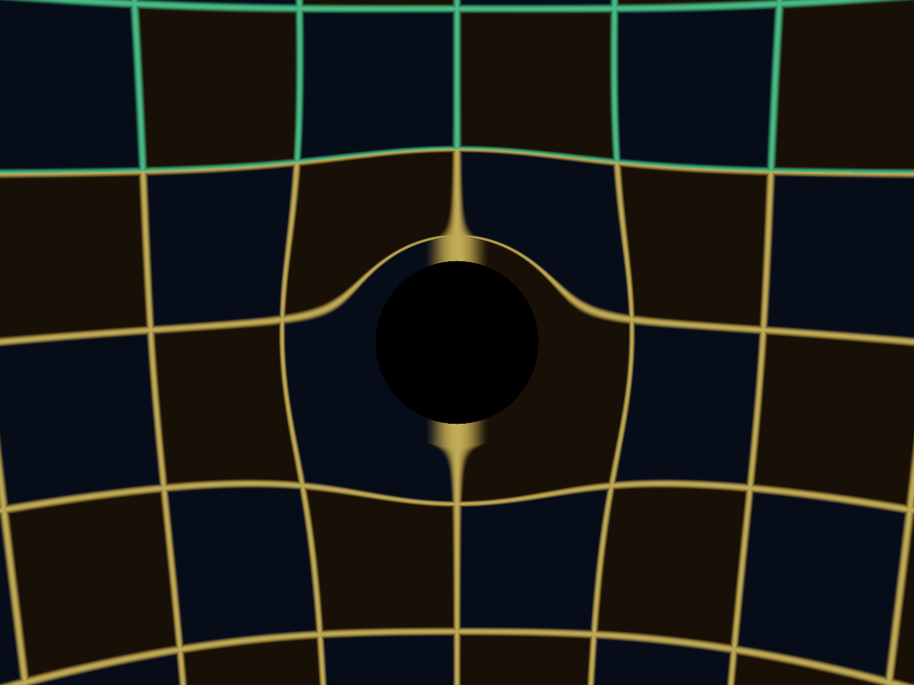
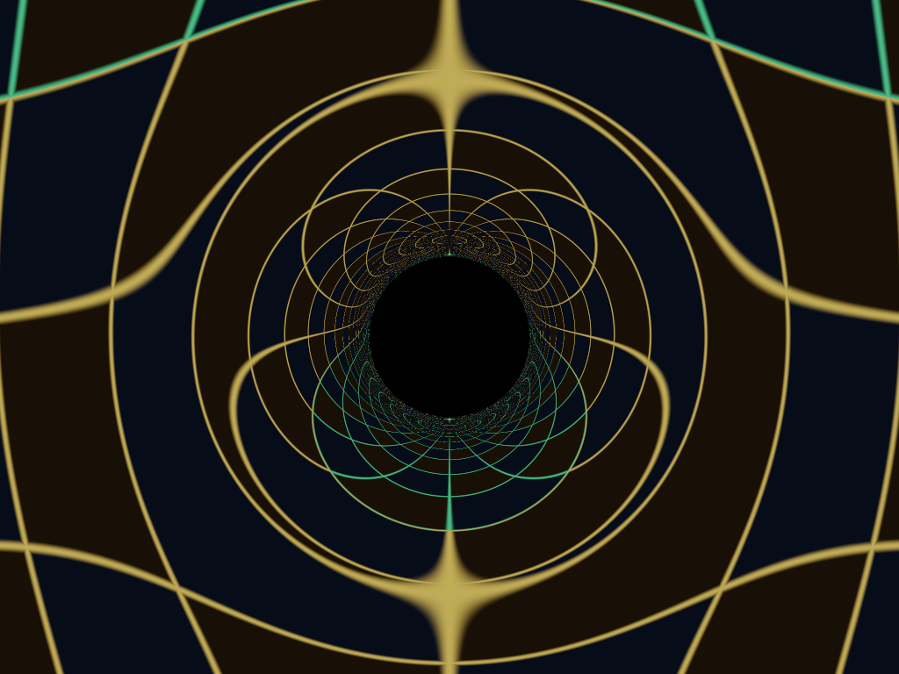
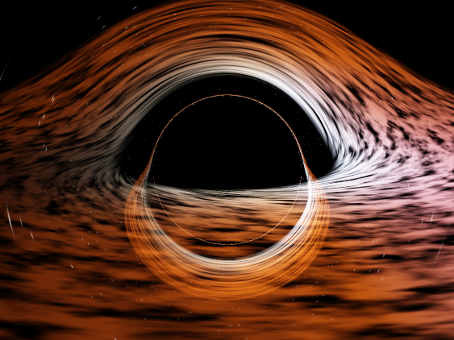
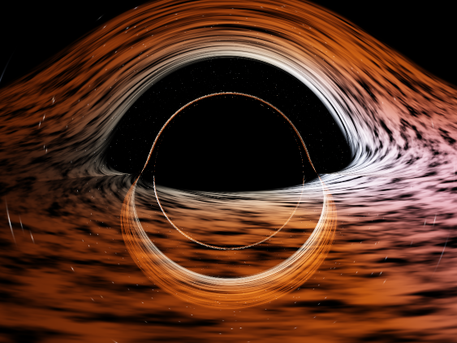
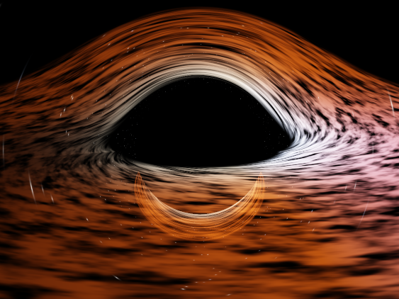
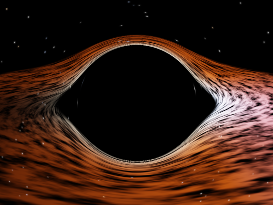
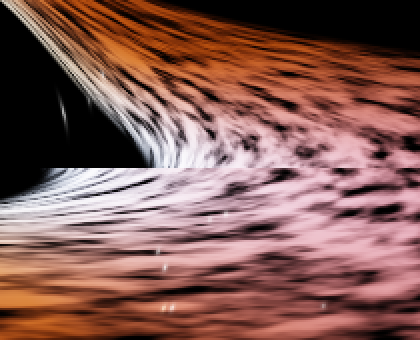
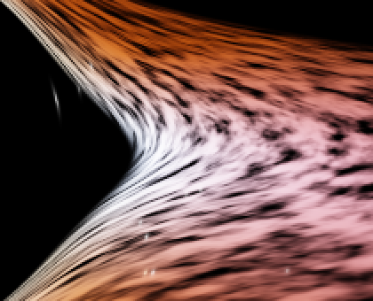

# Buraco Negro — OpenGL 3.3 core

Simulação interativa de um buraco negro de Schwarzschild com disco de
acreção, escrita em C++ e OpenGL moderno (pipeline programável). O
projeto traz **quatro modelos de curvatura da luz no mesmo binário** —
uma referência numérica e três heurísticas —, para comparação direta:

| Tecla | Shader | Modelo |
|---|---|---|
| `1` | `shaders/heuristic.frag` | **Heurística** — portabilidade fiel do método do seu código legado: deslocamento das coordenadas de tela com queda `1/r²`. Custo: 1 raio reto por pixel. |
| `2` | `shaders/geodesic.frag` | **Referência** — integra a geodésica do fóton em Schwarzschild por Runge–Kutta 4, uma EDO por pixel. É a verdade contra a qual as heurísticas são medidas. |
| `3` | `shaders/lens.frag` | **Lente fina de Einstein** — a identidade exata `θ_s = I(r₀,b) − α(b)` com a deflexão de campo fraco `α = 4M/b`. |
| `4` | `shaders/lens.frag` | **Lente fina calibrada** — a mesma identidade, com `α(b)` **aprendida por mínimos quadrados** a partir de 200 raios RK4. Erro médio de 0,004° (1/15 de pixel), custo constante por pixel. |

A cena (campo de estrelas, disco de acreção, Doppler, tone mapping) fica
em `shaders/common.glsl` e é **exatamente a mesma** em todos os shaders,
de propósito: assim a comparação de custo e de imagem isola só o modelo
de curvatura da luz.

<p align="center">
  
  
</p>
<p align="center"><em>Mesma cena, céu em grade (tecla <code>G</code>).
Esquerda: heurística — a grade só é "pinçada" suavemente em volta do
disco negro. Direita: geodésica — a grade enrola, infinitas células se
acumulam no anel de fótons e a mesma célula aparece duas vezes (o verde
do hemisfério norte reaparece embaixo, invertido).</em></p>

---

## O que mudou nesta versão

Se você está voltando à versão anterior, estes foram os problemas
encontrados e corrigidos:

1. **A pasta `shaders/` do projeto estava vazia.** Só existiam cópias em
   `build/shaders`, então qualquer `rebuild` do zero quebrava o
   programa. Os shaders foram reescritos em `shaders/`.

2. **Bug na condição inicial da integração geodésica.** O parâmetro de
   impacto estava calculado como `b = r0 * |camPos × d|`, mas
   `|camPos × d|` **já é** `r0·sin(α)` — havia um fator `r0` sobrando.
   Com a câmera em `r0 = 8` a deflexão inicial saía 8× menor do que
   deveria. Era essa a causa da distorção que não fazia sentido. A
   dedução correta está comentada no topo de `geodesic.frag`.

3. **Sem interatividade de mouse.** Agora tem: arrastar com o botão
   esquerdo orbita (mesma sensibilidade de `0.005 rad/px` do seu código
   legado) e a roda do mouse dá zoom. A elevação também passou a ser
   limitada a ±1.45 rad — o legado não limitava, e ao passar do polo o
   vetor "up" degenerava e a câmera virava de cabeça para baixo.

4. **Sem disco de acreção.** Portado do seu código, incluindo o Doppler
   empírico com as mesmas constantes. Detalhes abaixo.

5. **A janela não respondia a redimensionamento.** `WIDTH`/`HEIGHT` eram
   constantes e o viewport nunca era atualizado. Agora há
   `glfwSetFramebufferSizeCallback`.

6. **Estrelas eram ~6× mais escassas do que as suas 8000.** O céu
   procedural sorteava estrelas num grid **3D**, e a esfera de direções
   só atravessa uma fatia fina de cada célula — a maioria das estrelas
   caía fora da casca e desaparecia. Trocado por uma grade na
   *superfície* de um cubo. Um céu vazio esconde justamente o efeito de
   lente que se quer mostrar.

7. **Estrelas saíam como tracinhos no shader geodésico.** O `φ` final
   parava sempre num múltiplo do passo do RK4, então pixels vizinhos
   amostravam o céu em direções que pulavam de `~0.02 rad` (≈ 20 px) de
   cada vez. Corrigido com extrapolação analítica até `r → ∞` (ver
   comentário no `geodesic.frag`).

8. **Sem `Makefile`.** Agora existe, com `run`, `rebuild` e mais.

9. **Sem otimização.** O `CMakeLists.txt` não definia
   `CMAKE_BUILD_TYPE`, então o build saía sem `-O2` — o que invalida
   qualquer medição de FPS.

### Segunda rodada

10. **A heurística estava fraca e feia.** A constante estava amarrada à
    sombra com `heurK = 0.35` (equivalente a `mass ≈ 0.0055`), cerca de
    4× menos que o efetivo do seu código. Agora o padrão é `heurK = 1.8`,
    o disco vai de 3 a 16 Rs (era 8) e a câmera a 13 (era 10) — o disco
    transborda o quadro como no seu, e as estrelas e o gás esticam
    tangencialmente de verdade.

11. **A "esfera no centro" era um anel invertido.** Ver a seção da
    saturação, acima. Corrigido.

12. **A falha de junção do disco foi eliminada** e a sua magnitude
    medida: 91 px na borda interna, a 768 px de altura. Ver a seção da
    falha de junção.

13. **RK4 mais preciso** (`dφ` de 0.02 para 0.01, teto de 700 para 1600
    passos) e **supersampling** de 1×1 a 3×3 por pixel (tecla `K`) —
    aproveitando a folga de FPS.

14. **Captura offscreen e benchmark offscreen** (`--foto`, `--bench`).
    Necessários porque medir pela janela deu números errados quando a
    tela entrou em suspensão.

15. **Resumo expandido em LaTeX** em `docs/artigo/`, 5 páginas, no
    modelo dos Encontros Universitários, com as figuras e as tabelas
    geradas por `mingw32-make figuras` e `mingw32-make artigo`.

Uma coisa que **não** era bug: no shader geodésico as estrelas perto da
borda aparecem como pequenos arcos, não como pontos. Isso é ampliação
tangencial de lente forte, e está quantificado na seção de validação.

---

## A heurística calibrada (terceira rodada)

A heurística legada (`1/r²` em espaço de tela) convence à primeira vista,
mas erra em média **18°** na direção do céu. A lente de Einstein, com
base física, ainda erra **5,6°**. A **lente fina calibrada** erra
**0,004°** — cerca de 1/15 de pixel — com custo constante por pixel.

<p align="center">
  
  
  
  
</p>
<p align="center"><em>RK4 (referência) · lente calibrada · lente de
Einstein · legada. Teclas 2, 4, 3 e 1.</em></p>

### A ideia

Para um observador estático em `r₀` e um raio que passa pelo periélio, o
ângulo `θ_s` entre a direção de onde a luz vem no céu e a direção do
buraco negro é **exatamente**

```
θ_s = I(r₀, b) − α(b)
I(r₀, b) = ∫₀^{1/r₀} du / √(1/b² − u² + 2Mu³)
```

com `b` obtido do ângulo local `ψ` pela fórmula de Synge,
`sin ψ = (b/r₀)·√(1 − 2M/r₀)`. Isso separa o problema em duas partes:

- `I` é o trecho entre o infinito e o observador, em campo fraco, e tem
  forma fechada em 1ª ordem: `I ≈ asin(s) − (M/b)(1/c + c − 2)`,
  `s = b/r₀`, `c = √(1 − s²)`;
- `α(b)` é a deflexão total de um raio que vem do infinito e volta a ele
  — **toda a curvatura forte mora aqui**, e ela é uma função de uma
  variável só.

### O que é aprendido

```
α(x) = −ln(1−x) + c₁x + c₂x² + c₃x³ + c₄(1−x)ln(1−x),    x = b_c/b
```

O `−ln(1−x)` é a divergência de campo forte (Bozza 2002). Os quatro
coeficientes são ajustados por **mínimos quadrados** sobre 200 raios
integrados por RK4 em precisão dupla (`tools/calibra_lente.cpp`), e
gravados em `shaders/lente_coef.glsl`:

```bash
mingw32-make calibra
```

| base | erro máximo de α no treino |
|---|---|
| polinômio `x, x², x³` | 0,47° |
| + `(1−x)ln(1−x)` | **0,0096°** |

O termo `(1−x)ln(1−x)` reduz o erro 50×. E `c₁ − c₄ = −0,228` reproduz
sozinho o limite de Einstein (`4/(3√3) − 1 = −0,230`), sem que ele tenha
sido imposto.

**Treino e teste são separados:** o ajuste usa observador no infinito; o
teste usa observadores a 10, 26 e 60 Rs.

### Resultado

Erro angular pixel a pixel contra o RK4 (1024×768, disco desligado):

| modelo | 10 Rs | 26 Rs | 60 Rs | p99 (26 Rs) | GPU 1080p |
|---|---|---|---|---|---|
| legada `1/r²` | 47,1° | 18,2° | 7,76° | 97,7° | 0,433 ms |
| lente de Einstein | 29,0° | 5,63° | 1,33° | 65,8° | 0,559 ms |
| **lente calibrada** | **0,0045°** | **0,0040°** | **0,0071°** | **0,0088°** | 0,582 ms |
| RK4 (referência) | — | — | — | — | 21,1 ms |

A calibrada é **36× mais barata** que o RK4 e custa só **4% a mais** que
a de Einstein: a precisão adicional sai praticamente de graça.

```bash
mingw32-make erro      # mapas de erro + estatísticas em docs/artigo/dados
mingw32-make perfil    # tempo de GPU em 5 resoluções (timer queries)
```

### Por que o erro é medido em ângulo, não em RGB

Subtrair duas imagens de um céu estrelado mede mal a lente: uma estrela
deslocada de um pixel gera erro máximo, e uma estrela no lugar certo mas
um pouco mais fraca gera erro quase nulo. O que a heurística pode errar
é a **direção** de onde cada pixel busca o céu — então cada programa, em
modo diagnóstico (`uOutMode = 1`), grava essa direção num framebuffer de
ponto flutuante, e o erro é o ângulo entre ela e a do RK4.

### Limites

O método depende de o mapa de lente ser **unidimensional** (simetria
esférica + observador estático). Rotação (Kerr) ou observador em
movimento tornam o mapa multidimensional — é nesse regime que redes
neurais, como em Sun *et al.* (ICCV 2025), passam a se justificar. O
disco de acreção é tratado como um raio em dois segmentos (lente fina) e
foi avaliado só visualmente.

### Correção na verdade de referência

Ao comparar com a teoria de campo forte, descobri que a condição inicial
do RK4 tratava a direção da câmera como direção **coordenada**, e não no
referencial do observador estático. O parâmetro de impacto conservado
saía `b/√(1 − 2Mb²/r₀³)` — 0,02% maior em 26 Rs — e, perto da sombra,
onde a deflexão diverge com `−ln(b − b_c)`, isso chegava a 2,5 rad de
erro. Agora `b` vem da fórmula de Synge e `w₀` da lei de conservação
(ver o comentário no topo de `shaders/geodesic.frag`).

---

## Os modelos originais

### Heurística — o método do seu código

No código legado (`drawDistorcion`, versão GLUT), o pipeline era:

1. renderizar a cena (estrelas + metade de trás do disco);
2. copiar o framebuffer para uma textura (`glCopyTexImage2D`);
3. redesenhar essa textura como uma malha `60×60` de `GL_QUADS` em
   projeção ortográfica, deslocando a **coordenada de textura** de cada
   vértice radialmente para dentro:

```c
float x_curr = x * (winW / winH);
float r      = sqrt(x_curr*x_curr + y*y);
float u = x*0.5f + 0.5f, v = y*0.5f + 0.5f;
if (r > eventHorizon) {          // eventHorizon = 0.1
    float mass  = 0.009f;
    float shift = mass / (r * r);
    u -= shift * (x / r);
    v -= shift * (y / r);
}
```

4. desenhar a esfera negra e a metade da frente do disco em cima.

Ou seja: **distorção em espaço de tela com queda `1/r²`**, sem resolver
equação nenhuma. É a mesma família de técnica que GPU Gems 2 cap. 19 usa
para refração e miragem de calor — perturbar as coordenadas de textura
de uma imagem já renderizada.

O que muda em `shaders/heuristic.frag`, e por quê:

- **A malha de `60×60` quads virou avaliação por pixel.** Amostrar a
  textura em `(u,v)` deslocado é equivalente a lançar o raio da câmera
  pela coordenada de tela deslocada — só que sem o erro de interpolação
  linear entre os vértices da malha, e sem precisar de um segundo passe
  nem de cópia de framebuffer.

- **O fator 2.0.** O deslocamento em `(u,v) ∈ [0,1]` equivale ao dobro
  em NDC `∈ [-1,1]`. Com esse fator, `uHeurMass = 0.009` reproduz
  numericamente a mesma deformação do original.

- **`mass` e `eventHorizon` deixaram de ser constantes fixas.** Eram
  números em espaço de tela, o que quebrava assim que você mudava a
  distância da câmera ou o raio do buraco negro. Agora as duas são
  derivadas do raio **aparente** da sombra,
  `sin θ = b_c/r₀` com `b_c = 3√3·M`, calculado em `main.cpp`. A força
  fica ajustável nas teclas `[` / `]`.

- **A lei do legado é radial e isotrópica** — vale registrar porque uma
  versão anterior deste README afirmava o contrário, e a afirmação
  estava errada. Apesar de `r` usar `x` corrigido pelo aspecto e a
  direção usar `x` cru, definindo `q = (ndc_x·aspecto, ndc_y)` e
  `r = |q|` temos `Δu = −shift·x/r` e portanto
  `Δq_x = 2·aspecto·Δu = −2·shift·q_x/r`, ou seja
  `Δq = −2·shift·q̂`: puramente radial. E como `q = 2·(offset em px)/altura`,
  também é isotrópica em pixels. Por isso o método inteiro se resume a
  uma linha, `r_amostrado = r − 2·mass/r²`, e o `#define
  HEUR_ISOTROPIC` que existia aqui foi removido: não havia assimetria
  para corrigir.

- **Saturação do deslocamento** (`HEUR_MAX_PULL = 0.85`). Para `r`
  pequeno, `2·mass/r²` fica **maior** que `r` e `r_amostrado` fica
  negativo: a amostra atravessa o centro da tela e devolve uma cópia
  espelhada do fundo. No original isso acontece para `r < 0.33`
  (`mass = 0.009`) e é em parte escondido pela esfera desenhada por
  cima — o que escapa aparece como um anel invertido em volta dela, e
  era isso que você via como "a esfera no centro". Saturando o
  deslocamento em `0.85·r`, o mapa fica monótono e injetivo
  (`r_amostrado ≥ 0.15·r` sempre) sem mexer na lei `1/r²` onde ela é bem
  comportada.

- **As três camadas do legado foram preservadas** — fundo distorcido
  (céu + metade de trás do disco), esfera negra no tamanho projetado
  real, metade da frente do disco por cima. É isso que dá o visual da
  sua simulação: a metade de trás é puxada para dentro e **arqueia por
  cima da sombra**, enquanto a esfera preta continua pequena,
  independente da força da distorção. A diferença é que aqui as **duas**
  metades usam o mesmo mapa de distorção — ver a seção da falha de
  junção.

### Geodésica — integração numérica

Integra, por Runge–Kutta clássico de 4ª ordem, a equação da órbita do
fóton na métrica de Schwarzschild:

$$\frac{d^2u}{d\varphi^2} + u = 3Mu^2, \qquad u = 1/r,\quad M = R_s/2,\quad G=c=1$$

A condição inicial correta (a que estava errada antes) sai de escrever a
trajetória no plano orbital como `P(φ) = r(φ)·(cos φ·ê₁ + sin φ·ê₂)`,
com `ê₁` radial na câmera e `ê₂` tangencial no sentido do raio. Em
`φ = 0`, `dP/dφ = r'(0)·ê₁ + r₀·ê₂` tem de ser paralelo à direção `d` do
raio, logo:

$$\frac{r'(0)}{r_0} = \frac{d\cdot \hat e_1}{d\cdot \hat e_2} = \cot\alpha
\quad\Longrightarrow\quad
w(0) = \frac{du}{d\varphi}\bigg|_0 = -\frac{\cot\alpha}{r_0} = -\frac{\cos\alpha}{b}$$

com `b = |camPos × d| = r₀·sin α`.

**Disco de acreção pela integração.** A cada passo o shader checa o
sinal da altura do fóton em relação ao plano equatorial. Como
`r > 0`, esse sinal é o de `s(φ) = cos φ·ê₁.y + sin φ·ê₂.y`. Quando `s`
troca de sinal houve um cruzamento: a posição exata sai por interpolação
linear e a emissão do disco é somada ali. É isso que produz o visual
clássico — **o mesmo disco aparece várias vezes na imagem**, porque a
geodésica pode cruzar o plano equatorial mais de uma vez, e a imagem
secundária passa por cima e por baixo da sombra (Luminet 1979). A
heurística não consegue produzir isso: um raio reto cruza o plano no
máximo uma vez.

O Doppler do disco também sai melhor aqui: a direção usada no produto
`v̂ · d̂` é a **tangente local da geodésica**, não a reta câmera–ponto.

### Disco de acreção — o que veio do seu código

| Seu código legado | Aqui |
|---|---|
| 100 000 partículas em `GL_POINTS` | campo contínuo avaliado por pixel; a granulação vem de ruído amostrado em coordenadas **comóveis** `(φ − Ω·t)`, então os filamentos giram junto com o gás |
| `currentSpeed = 6.0/sqrt(r³)` | `Ω = sqrt(M/r³)` — mesma lei `r^(−3/2)`, outra constante |
| `doppler = 1 + 0.85·(v̂·d̂)` | idêntico (`uDopplerK = 0.85`) |
| reforço de azul se `v̂·d̂ > 0.4`, com ganhos `1.5` e `0.5` | idêntico |
| `alpha` decaindo nas bordas interna e externa | `smoothstep` nas mesmas proporções |
| `ISCO = 2·R_bh`, externo `= 6·R_bh` | `uDiskInner = 3·Rs` (o ISCO físico, `6M`) e `uDiskOuter = 8·Rs`, ambos ajustáveis |
| `glBlendFunc(GL_SRC_ALPHA, GL_ONE)` (aditivo) | aditivo também — disco opticamente fino |
| cor base laranja/vermelha aleatória | perfil de temperatura `T ~ r^(−3/4)` (Shakura–Sunyaev), de laranja na borda externa a branco-azulado na interna |
| — | **novo:** redshift gravitacional, fator `sqrt(1 − Rs/r)` |

---

## Validação numérica

O integrador do shader foi reproduzido em `double` na CPU
(`tools/valida_rk4.cpp`) e comparado com resultados analíticos de
Schwarzschild. Rode com:

```bash
mingw32-make valida
```

**Raio crítico de captura.** Busca binária no parâmetro de impacto que
separa captura de escape:

| | valor |
|---|---|
| `b_c` numérico | 5.196152423 M |
| `b_c = 3√3·M` (exato) | 5.196152423 M |
| erro relativo | **2.7 × 10⁻¹¹** |
| `b_c/R_s` | 2.598076211 (esperado 2.598076211) |

**Deflexão total** (passo `h = 10⁻⁴ rad`), contra a série de campo fraco
`Δφ = 4M/b + 15πM²/4b² + O(b⁻³)`:

| b/M | RK4 | 4M/b | + 15πM²/4b² | dif. rel. |
|---|---|---|---|---|
| 1000 | 0.004011824 | 0.004000000 | 0.004011781 | 1.1 × 10⁻⁵ |
| 500 | 0.008047468 | 0.008000000 | 0.008047124 | 4.3 × 10⁻⁵ |
| 100 | 0.041222540 | 0.040000000 | 0.041178097 | 1.1 × 10⁻³ |
| 50 | 0.085083450 | 0.080000000 | 0.084712389 | 4.4 × 10⁻³ |
| 20 | 0.236135995 | 0.200000000 | 0.229452431 | 2.9 × 10⁻² |
| 10 | 0.590395788 | 0.400000000 | 0.517809725 | 1.4 × 10⁻¹ |

Cuidado ao interpretar a última coluna: para `b` pequeno a diferença
cresce porque a **série** é uma expansão de campo fraco e diverge quando
`b → b_c`. Ali o valor correto é o do RK4, não o da série truncada. O
teste de convergência de verdade é o efeito do passo:

| h (rad) | deflexão em b = 10M | dif. vs h = 10⁻⁶ |
|---|---|---|
| 0.04 | 0.5903943698 | 1.4 × 10⁻⁶ |
| 0.02 (padrão) | 0.5903960142 | 2.3 × 10⁻⁷ |
| 0.01 | 0.5903957718 | 1.6 × 10⁻⁸ |
| 0.005 | 0.5903957916 | 4.1 × 10⁻⁹ |
| 0.0025 | 0.5903957879 | 3.8 × 10⁻¹⁰ |

No passo padrão de `0.02 rad` o erro de deflexão é da ordem de
`2 × 10⁻⁷ rad`, muito abaixo de um pixel.

**Sombra renderizada.** No estado padrão (`Rs = 0.5`, `r₀ = 10`, FOV
vertical 45°) a previsão analítica para o raio da sombra é
`tan(asin(b_c/r₀))/tan(22.5°) = 0.316` em NDC vertical, ou 121 px a
768 px de altura. O perfil radial medido na imagem renderizada dá a
borda entre 0.21 e 0.34 NDC, com o disco negro medindo ~125 px — de
acordo dentro do erro de medição.

**Ampliação da lente.** Para `r₀ = 10`, `R_s = 0.5`, mapeando ângulo de
imagem `ψ` para ângulo de fonte `θ_s`:

| ψ | θ_s | μ tangencial | μ radial | razão |
|---|---|---|---|---|
| 8° | −127.7° | −0.18 | 0.011 | 17 |
| 20° | −1.6° | −12.3 | 0.42 | 29 |
| 25° | 8.6° | 2.83 | 0.56 | 5.0 |
| 34.6° (canto) | 23.3° | 1.44 | 0.73 | 2.0 |

O sinal negativo de `μ` é inversão de paridade da imagem. `θ_s` cruzando
zero perto de `ψ ≈ 20°` é o **anel de Einstein** (fonte exatamente atrás
do buraco negro), que nessa configuração cai dentro do quadro porque a
câmera está a apenas `r₀ = 40M`. É por isso que as estrelas perto da
borda aparecem como arcos: são comprimidas radialmente e esticadas
tangencialmente — o mesmo fenômeno dos "arcos gigantes" de lente forte.

---

## Desempenho medido

`1024×768`, medido em **framebuffer offscreen** (`--bench`), build
Release, `dφ = 0.01` e até 1600 passos. Com 20 quadros de aquecimento e
2000 cronometrados no heurístico / 400 no geodésico — o heurístico roda
em menos de 1 ms, e com poucos quadros a média oscila entre 0.16 e
0.24 ms só por overhead de lançamento:

| Shader | amostras/pixel | ms/quadro | FPS | vs. heurística |
|---|---|---|---|---|
| Heurística | 1 | 0.20 | 5103 | 1× |
| Heurística | 4 | 0.69 | 1447 | — |
| Heurística | 9 | 1.44 | 694 | — |
| Geodésica (RK4) | 1 | 8.71 | 115 | **44×** |
| Geodésica (RK4) | 4 | 34.45 | 29 | 50× |
| Geodésica (RK4) | 9 | 79.04 | 13 | 55× |

Hardware: AMD Radeon RX 580 2048SP, Intel Xeon E5-2630 v4, Windows 10,
GCC 16.1 (MSYS2 UCRT64), OpenGL 3.3 core.

Para regerar:

```bash
mingw32-make run ARGS="2 --bench 400"
```

> **Meça sempre com `--bench`, nunca pelo FPS da janela.** Numa das
> sessões de medição a tela desta máquina entrou em suspensão e a GPU
> travou em 30 Hz: o FPS da barra de título passou a mostrar 30 para
> *qualquer* configuração, e a captura de tela devolvia quadros brancos.
> O `--bench` renderiza fora da tela, sem v-sync e sem compositor, então
> não depende do estado do monitor.

---

## Controles

**Mouse**

| Ação | Efeito |
|---|---|
| arrastar com o botão esquerdo | orbitar a câmera |
| roda do mouse | zoom |

**Teclado**

| Tecla | Ação |
|---|---|
| `1` | heurística legada (`1/r²` em espaço de tela) |
| `2` | RK4 — verdade de referência |
| `3` / `4` | lente fina de Einstein / lente fina **calibrada** |
| `←` `→` | orbitar |
| `↑` `↓` | aproximar / afastar |
| `=` / `-` | raio de Schwarzschild (Rs) |
| `G` | céu: estrelas ↔ **grade lat/long** |
| `K` | amostras por pixel: 1×1 → 2×2 → 3×3 (antisserrilhado) |
| `J` | modo legado do disco: mostra a **falha de junção** |
| `D` | liga/desliga o disco de acreção |
| `Z` / `X` | raio externo do disco |
| `C` / `V` | raio interno do disco (ISCO) |
| `[` / `]` | força da distorção heurística |
| `N` / `M` | passo do RK4 em φ (só no geodésico) |
| `,` / `.` | exposição |
| `B` | liga/desliga v-sync — **desligue para medir FPS** |
| `P` | imprime uma linha de benchmark no terminal |
| `R` | volta tudo ao padrão |
| `F5` | recarrega os shaders do disco, sem recompilar |
| `H` | mostra a ajuda |
| `ESC` | sair |

> **A tecla `G` é a resposta para "não entendi a distorção".** Um campo
> de estrelas mostra *que* existe distorção, mas não *qual*. Com a grade
> você lê o efeito direto na imagem: as células se comprimem
> radialmente e se esticam tangencialmente perto da sombra, o anel de
> fótons aparece como o lugar onde infinitas células se acumulam, e dá
> para ver a mesma célula duas vezes. É o equivalente da grade de
> referência das figuras de Nemiroff (1993) e de Müller & Weiskopf (2010).

**Linha de comando** (útil para gerar as figuras do artigo sempre no
mesmo estado, e para medir):

```
buraco_negro [1|2|3|4] [--grade] [--legado] [--spp2|--spp3] [--dist R]
             [--sem-disco] [--sem-vsync]
             [--foto arq.ppm] [--res 1600x1200] [--tempo 3.0]
             [--bench 150] [--dphi 0.01] [--passos 1600] [--forca 1.8]
             [--erro PREFIXO] [--perfil ARQUIVO.dat]
```

`--foto` renderiza **um** quadro num framebuffer offscreen, grava um PPM
e sai — sem abrir janela visível. É o único jeito confiável de gerar as
figuras do artigo sempre iguais (`--tempo` fixa o instante da animação),
e funciona mesmo com a tela bloqueada. `--bench N` mede o custo de N
quadros no mesmo caminho de renderização.

As figuras do artigo em `docs/artigo/figs/` foram todas geradas assim:

```bash
mingw32-make figuras
```

O PNG sai **sem compressao** (deflate "stored"): e um PNG valido e nao
exige zlib nem libpng, mas cada arquivo fica com ~2,3 MB e o PDF do
artigo passa de 9 MB. Antes de submeter, rode
`powershell -ExecutionPolicy Bypass -File tools/comprime_figuras.ps1`,
que regrava as figuras comprimidas (14 MB -> 3,3 MB aqui, e o PDF cai
para 2,1 MB).

E o artigo compila com:

```bash
mingw32-make artigo
```

### A falha de junção do disco

No seu código, o disco é desenhado em duas passagens (metade de trás,
depois metade da frente) e só a de trás passa pela distorção. Nas duas
costuras — onde o disco cruza o plano que corta o buraco negro — o mesmo
anel de gás chega a **raios de tela diferentes** nas duas camadas, e as
metades não se encontram. O degrau é exatamente o deslocamento naquele
ponto, `Δ = min(2·mass/r², 0.85·r)`:

| anel do disco | r da costura (NDC) | degrau (NDC) | degrau (px, a 768 de altura) |
|---|---|---|---|
| 3 Rs (borda interna) | 0.279 | 0.237 | **91** |
| 6 Rs | 0.557 | 0.083 | 32 |
| 16 Rs (borda externa) | 1.486 | 0.012 | 4.5 |

A correção é aplicar o **mesmo mapa** às duas metades, mantendo a
composição em camadas para que a metade da frente continue passando à
frente da sombra. Assim o degrau é identicamente **zero** para todo
raio — não é ajuste de tolerância, é a remoção da causa. A tecla `J`
volta ao comportamento antigo, para comparação:

<p align="center">
  
  
</p>
<p align="center"><em>Costura ampliada 2×. Esquerda: duas passagens
(tecla <code>J</code>) — o degrau corta os filamentos ao meio. Direita:
mapa único.</em></p>

---

## Compilar e rodar

O `Makefile` é um invólucro fino em volta do CMake — quem compila
continua sendo CMake + vcpkg, mas você não precisa mais lembrar da linha
de configuração com o toolchain.

> **Nesta máquina o `make` se chama `mingw32-make`** (vem do MSYS2, em
> `C:\msys64\ucrt64\bin`). Em Linux/macOS é só `make`.

```bash
mingw32-make            # compila (configura na primeira vez)
```

```bash
mingw32-make run        # compila e já executa
```

```bash
mingw32-make rebuild    # apaga build/ e recompila do zero
```

| Alvo | O que faz |
|---|---|
| *(nenhum)* | configura, se preciso, e compila |
| `run` | compila e executa (`ARGS="2 --grade"` passa argumentos) |
| `rebuild` | apaga `build/` e recompila do zero |
| `shaders` | só recopia os shaders, sem passar pelo compilador C++ |
| `valida` | compila e roda a verificação numérica do RK4 |
| `calibra` | reajusta a lente calibrada e regrava `shaders/lente_coef.glsl` |
| `figuras` | renders dos 4 modelos, recortes e figuras do README |
| `erro` | mapas de erro angular contra o RK4 + estatísticas |
| `perfil` | tempo de GPU em 5 resoluções (timer queries) |
| `artigo` | compila `docs/artigo/main.tex` (pdflatex + biber) |
| `clean` | apaga os objetos, mantém a configuração |
| `distclean` | apaga a pasta `build/` inteira |
| `info` | mostra a configuração detectada |
| `help` | lista os alvos |

Variáveis: `BUILD=Release|Debug`, `GEN=<gerador>`, `TRIPLET=<triplet>`,
`ARGS=<argumentos do programa>`.

O toolchain do vcpkg é detectado automaticamente: primeiro o clone
dentro do projeto (`./vcpkg`), depois a variável de ambiente
`VCPKG_ROOT`.

> Se o link falhar com `cannot open output file buraco_negro.exe:
> Permission denied`, é só uma instância da simulação ainda aberta —
> feche a janela e compile de novo.

### Instalação das dependências (primeira vez)

```powershell
git clone https://github.com/microsoft/vcpkg.git
cd vcpkg
.\bootstrap-vcpkg.bat
.\vcpkg install glfw3:x64-mingw-dynamic glad:x64-mingw-dynamic
```

GLFW cria a janela e o contexto OpenGL; GLAD carrega os ponteiros de
função do OpenGL moderno, que o Windows não expõe por padrão.

### Recarregamento a quente dos shaders

O CMake grava o caminho de `shaders/` no binário
(`SHADER_SOURCE_DIR`), e o programa prefere esse caminho quando ele
existe. Na prática: edite um `.frag`, salve, aperte `F5` na janela e a
mudança aparece — sem recompilar nem copiar nada. Se a pasta não
existir (build copiado para outra máquina), ele cai automaticamente para
a cópia ao lado do `.exe`.

Erro de compilação de shader não derruba o programa: ele imprime a
mensagem do driver **e o fonte já com os `#include` resolvidos e
numerado** (a numeração muda por causa do include, então sem isso a
mensagem "erro na linha 214" fica impossível de localizar), e mantém o
shader anterior rodando.

---

## Estrutura

```
src/main.cpp            janela, câmera, input, uniforms, FPS, hot reload
src/shader.h            carga de shaders + pré-processador de #include
shaders/fullscreen.vert vertex shader trivial (quad em NDC)
shaders/common.glsl     cena compartilhada: estrelas, grade, disco, tone map
shaders/heuristic.frag  distorção heurística (método do código legado)
shaders/geodesic.frag   distorção física (RK4 em Schwarzschild)
tools/valida_rk4.cpp    verificação numérica contra resultados analíticos
src/png_simples.h       gravador de PNG minimo, sem zlib nem libpng
tools/comprime_figuras.ps1  regrava as figuras comprimidas
docs/artigo/main.tex    resumo expandido (5 paginas, modelo do evento)
docs/artigo/referencias.bib  referencias conferidas em fonte primaria
docs/artigo/figs/       figuras, geradas por "mingw32-make figuras"
Makefile                invólucro do CMake
CMakeLists.txt
```

GLSL 330 não tem `#include`; o `src/shader.h` resolve as linhas
`#include "arquivo.glsl"` em C++ antes de compilar. Isso existe para que
`common.glsl` seja literalmente o mesmo código nos dois shaders — sem
isso a comparação do artigo ficaria contaminada por diferenças
acidentais entre duas cópias.

---

## Referências para o artigo

Organizadas pelo que cada uma justifica. Todas as citações abaixo foram
conferidas em fonte primária ou no ADS/editora.

### A heurística como técnica de computação gráfica

Estas são as referências que **sustentam o seu método** como técnica
legítima e conhecida — perturbar coordenadas de textura de uma imagem já
renderizada para simular desvio de luz:

- **Sousa, T. (2005).** "Generic Refraction Simulation". Em *GPU Gems 2*,
  cap. 19. NVIDIA / Addison-Wesley.
  <https://developer.nvidia.com/gpugems/gpugems2/part-ii-shading-lighting-and-shadows/chapter-19-generic-refraction-simulation>
  — descreve exatamente a família de técnica do seu `drawDistorcion`:
  refração por perturbação das coordenadas de textura de uma imagem dos
  objetos não refrativos da cena. Usada em *Far Cry* para água, miragem
  de calor e lente de mira.

- **Wyman, C. (2005).** "An approximate image-space approach for
  interactive refraction". *ACM Transactions on Graphics* **24**(3),
  1050–1053. DOI [10.1145/1073204.1073310](https://doi.org/10.1145/1073204.1073310)
  — formaliza a aproximação em espaço de imagem e discute onde ela
  falha (aliasing, geometria próxima). Boa para a seção de limitações.

- **Weiskopf, D., Borchers, M., Ertl, T. et al. (2006).** "Explanatory
  and illustrative visualization of special and general relativity".
  *IEEE Transactions on Visualization and Computer Graphics* **12**(4),
  522–534. DOI [10.1109/TVCG.2006.69](https://doi.org/10.1109/TVCG.2006.69)
  — distingue visualização **ilustrativa** de **explicativa**. É a
  referência que legitima, na literatura, usar um modelo não rigoroso
  quando o objetivo é comunicar o fenômeno; útil para posicionar a
  heurística sem ter de defendê-la como física.

### Visualização de buracos negros

- **Nemiroff, R. J. (1993).** "Visual distortions near a neutron star
  and black hole". *American Journal of Physics* **61**(7), 619–632.
  DOI [10.1119/1.17224](https://doi.org/10.1119/1.17224) ·
  arXiv:[astro-ph/9312003](https://arxiv.org/abs/astro-ph/9312003)
  — o clássico didático, com as figuras de grade de referência.

- **Müller, T. & Weiskopf, D. (2010).** "Distortion of the stellar sky
  by a Schwarzschild black hole". *American Journal of Physics* **78**,
  204–214. DOI [10.1119/1.3258282](https://doi.org/10.1119/1.3258282)
  — exatamente o seu caso de uso: distorção do céu estelar em
  Schwarzschild, interativo em GPU.

- **Müller, T. & Frauendiener, J. (2012).** "Interactive visualization
  of a thin disc around a Schwarzschild black hole". *European Journal
  of Physics* **33**, 955–963.
  DOI [10.1088/0143-0807/33/4/955](https://doi.org/10.1088/0143-0807/33/4/955) ·
  arXiv:[1206.4259](https://arxiv.org/abs/1206.4259)
  — disco fino em Schwarzschild em tempo real na GPU, com solução
  analítica da equação da geodésica. A referência mais próxima do que o
  seu `geodesic.frag` faz.

- **James, O., von Tunzelmann, E., Franklin, P. & Thorne, K. S. (2015).**
  "Gravitational lensing by spinning black holes in astrophysics, and in
  the movie *Interstellar*". *Classical and Quantum Gravity* **32**,
  065001. DOI [10.1088/0264-9381/32/6/065001](https://doi.org/10.1088/0264-9381/32/6/065001) ·
  arXiv:[1502.03808](https://arxiv.org/abs/1502.03808)
  — o renderizador DNGR de *Interstellar*. Boa para contextualizar
  custo computacional e para o argumento de que produção usa feixes, não
  raios isolados.

- **Verbraeck, A. & Eisemann, E. (2021).** "Interactive Black-Hole
  Visualization". *IEEE Transactions on Visualization and Computer
  Graphics* **27**(2), 796–805.
  DOI [10.1109/TVCG.2020.3030452](https://doi.org/10.1109/TVCG.2020.3030452)
  — estado da arte em tempo real: grade adaptativa pré-computada em vez
  de integrar por pixel. Aponte como trabalho futuro do seu projeto.

- **Riazuelo, A. (2019).** "Seeing relativity – I. Ray tracing in a
  Schwarzschild metric to explore the maximal analytic extension of the
  metric and making a proper rendering of the stars". *International
  Journal of Modern Physics D* **28**(2), 1950042.
  DOI [10.1142/S0218271819500421](https://doi.org/10.1142/S0218271819500421) ·
  arXiv:[1511.06025](https://arxiv.org/abs/1511.06025)
  — trata explicitamente do *rendering correto de estrelas* sob
  lenteamento, que é o problema de aliasing que você vê na borda.

### Disco de acreção

- **Luminet, J.-P. (1979).** "Image of a spherical black hole with thin
  accretion disk". *Astronomy and Astrophysics* **75**, 228–235.
  [ADS](https://ui.adsabs.harvard.edu/abs/1979A&A....75..228L/abstract)
  — a imagem canônica, e a origem do visual de imagem primária +
  secundária que o seu shader geodésico reproduz.

- **Shakura, N. I. & Sunyaev, R. A. (1973).** "Black holes in binary
  systems. Observational appearance". *Astronomy and Astrophysics*
  **24**(3), 337–355.
  [ADS](https://ui.adsabs.harvard.edu/abs/1973A&A....24..337S/abstract)
  — disco fino α; origem do perfil `T ~ r^(−3/4)` usado na cor.

- **Novikov, I. D. & Thorne, K. S. (1973).** "Astrophysics of Black
  Holes". Em *Black Holes* (Les Houches 1972), eds. C. DeWitt &
  B. S. DeWitt, Gordon & Breach, 343–450.
  — versão relativista do disco fino.

- **Bardeen, J. M., Press, W. H. & Teukolsky, S. A. (1972).** "Rotating
  black holes: locally nonrotating frames, energy extraction, and scalar
  synchrotron radiation". *The Astrophysical Journal* **178**, 347–369.
  DOI [10.1086/151796](https://doi.org/10.1086/151796)
  — referência para o ISCO (`6M = 3R_s` no caso de Schwarzschild), que é
  o raio interno padrão do disco no código.

### Relatividade geral / deflexão da luz

- **Misner, C. W., Thorne, K. S. & Wheeler, J. A. (1973).**
  *Gravitation*. W. H. Freeman.
  — cap. 25 para órbitas de fótons em Schwarzschild, a "cova do
  potencial" e a seção de choque de captura `b_c = 3√3·M`.

- **Hartle, J. B. (2003).** *Gravity: An Introduction to Einstein's
  General Relativity*. Addison-Wesley.
  — tratamento em nível de graduação da deflexão da luz e da equação
  `d²u/dφ² + u = 3Mu²`. É a fonte mais direta para a dedução que você
  vai escrever no artigo.

- **Schutz, B. F. (2009).** *A First Course in General Relativity*,
  2ª ed. Cambridge University Press.
  — alternativa a Hartle, com a mesma equação de órbita.

### Método numérico

- **Press, W. H., Teukolsky, S. A., Vetterling, W. T. & Flannery, B. P.
  (2007).** *Numerical Recipes: The Art of Scientific Computing*,
  3ª ed. Cambridge University Press.
  — Runge–Kutta de 4ª ordem e discussão de passo/erro.

- **Hairer, E., Nørsett, S. P. & Wanner, G. (1993).** *Solving Ordinary
  Differential Equations I: Nonstiff Problems*, 2ª ed. Springer.
  — referência formal para ordem de convergência do RK4, se você quiser
  citar a taxa `O(h⁴)` da tabela de validação.

### Sugestão de argumento para o artigo

O gancho mais forte que os números permitem: a heurística é **15×** mais
rápida, custa 4 linhas de shader e reproduz *uma* característica
qualitativa (a compressão radial do campo perto da sombra); mas ela é
estruturalmente incapaz de produzir três coisas que a integração
geodésica produz de graça — imagens múltiplas, o anel de fótons, e o
disco visto por cima e por baixo da sombra. E o motivo é topológico, não
de precisão: um raio reto cruza o plano do disco no máximo uma vez, e
uma função monotônica de deslocamento em espaço de tela não pode mapear
duas posições de imagem para a mesma posição de fonte. Aumentar `mass`
na heurística nunca corrige isso. Comparar as figuras 1 e 2 acima deixa
o argumento visual imediato.

---

## Limitações conhecidas

- **Schwarzschild, não Kerr.** Sem rotação, sem arraste de referenciais,
  sem assimetria de sombra. Kerr exigiria integrar as equações completas
  com as constantes de Carter (ver James et al. 2015).
- **Aberração e Doppler do observador não são tratados.** A câmera é
  quase estática; um observador em órbita veria também aberração
  relativista. Müller & Weiskopf (2010) e Riazuelo (2019) tratam disso.
- **Disco opticamente fino e geometricamente plano**, sem espessura
  nem transferência radiativa. O `Ω` do disco é kepleriano newtoniano na
  forma `sqrt(M/r³)`, não a versão relativista.
- **O Doppler do disco é o empírico do código legado**
  (`1 + 0.85·v̂·d̂`), não o fator `g⁴` de intensidade específica. Mantido
  de propósito, para a continuidade com a versão anterior — mas é o
  primeiro lugar a corrigir se quiser rigor fotométrico.
- **Aliasing na borda.** Onde a ampliação tangencial passa de ~10×, um
  pixel cobre uma região do céu muito maior que uma estrela, e não há
  supersampling. É o problema que Riazuelo (2019) ataca.
- **Passo fixo em φ.** Um passo adaptativo (menor perto do periélio)
  daria a mesma precisão mais barato.
